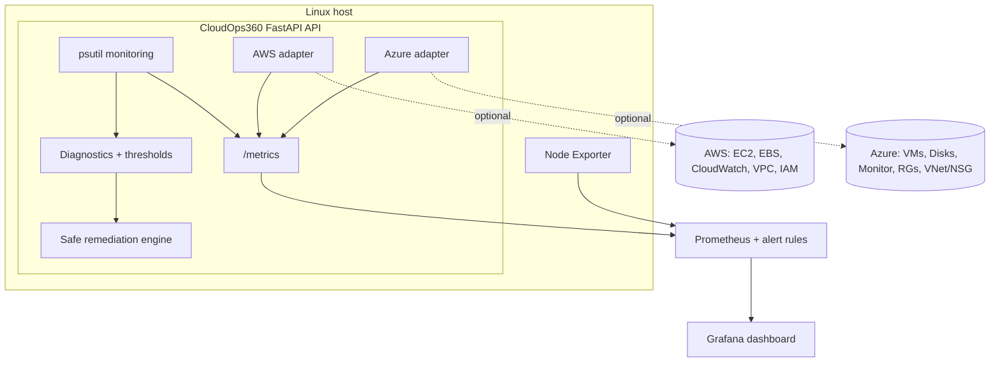

# CloudOps360

**Multi-cloud infrastructure monitoring, diagnostics and safe auto-remediation platform** - a portfolio project that
looks and behaves like a small real-world Cloud Operations tool, and runs entirely on a laptop with **no AWS or Azure
account**.


## Overview

CloudOps360 monitors a Linux host in real time (psutil), exports the data to Prometheus, visualises it in a
pre-provisioned Grafana dashboard, diagnoses problems through a REST API, and can fix a **small, explicitly
allow-listed** set of problems - dry-run by default. When AWS or Azure credentials are present it also discovers and
reports cloud resources; when they are not, those features switch off cleanly and the rest keeps working.

## Problem statement

Operations teams drown in signals. They need to (1) see health across hosts and clouds in one place, (2) get an
explanation, not just an alert, and (3) automate the boring, low-risk fixes - **without** automation becoming the next
outage. CloudOps360 demonstrates that loop with safety as the primary design constraint.

## Architecture



More detail and sequence diagrams: [docs/architecture.md](docs/architecture.md).

## Features

* **Local monitoring** - CPU, memory/swap, filesystems, disk I/O, network traffic/errors/drops, load, uptime,
  processes, allow-listed service state.
* **REST API** - health, status, hosts, diagnostics, remediation status/dry-run/execute, AWS/Azure overviews,
  Prometheus metrics. Pydantic models, consistent JSON errors, request IDs.
* **Configurable thresholds** via environment variables (`CPU_THRESHOLD`, `MEMORY_THRESHOLD`, `DISK_THRESHOLD`,
  `LOAD_THRESHOLD`).
* **Safe remediation** - allowlist, dry-run default, guarded execution, verification, audit logs (see
  [docs/security.md](docs/security.md)).
* **Prometheus + Grafana** - scrape config, 7 alert rules, provisioned datasource and 30+ panel dashboard.
* **AWS adapter** (boto3) - EC2, EBS, CloudWatch, VPC, identity. **Azure adapter** - VMs, disks, resource groups,
  VNet/NSG, Azure Monitor. Both: read-only, cached, optional.
* **Terraform** examples for AWS and Azure (small, cost-aware, never auto-applied).
* **CI** - lint, format, tests, bandit, pip-audit, Terraform validate, shellcheck, Docker build + smoke test,
  promtool, Trivy.
* **Structured JSON logging** with secret redaction.

## Tech stack

Python 3.11+, FastAPI, Pydantic v2, Uvicorn, psutil, prometheus-client, boto3, Azure SDK (identity, compute, network,
resource, monitor), pytest, Ruff, Black, Bandit, Docker, Docker Compose, Prometheus, Grafana, Node Exporter,
Terraform (AWS + AzureRM providers), GitHub Actions, Bash.

## Project structure

```
cloudops360/
├── app/
│   ├── main.py                 # app factory, middleware, error handlers
│   ├── config.py               # env-driven Settings (validated, fail-fast)
│   ├── logging_config.py       # JSON logs + redaction
│   ├── container.py            # dependency wiring
│   ├── api/                    # routes.py, diagnostics.py, remediation.py, cloud.py, deps.py
│   ├── monitoring/             # system.py (psutil + thresholds), services.py, metrics.py
│   ├── remediation/            # engine.py, safety.py
│   ├── cloud/                  # aws.py, azure.py, base.py, models.py, refresher.py
│   └── models/schemas.py
├── tests/                      # 90+ test cases, no cloud credentials needed
├── prometheus/                 # prometheus.yml, alerts.yml
├── grafana/                    # provisioning + dashboards/cloudops360.json
├── terraform/{aws,azure}/      # root + modules
├── scripts/                    # health_check.sh, disk_check.sh, setup.sh, demo unit
├── docs/                       # architecture, setup, aws, azure, security, troubleshooting, interview-guide
├── .github/workflows/ci.yml
├── Dockerfile  docker-compose.yml  Makefile  pyproject.toml  requirements*.txt  .env.example
```

## Local setup (Windows 11 + WSL2 Ubuntu 24.04)

Full instructions: [docs/setup.md](docs/setup.md). Short version, inside Ubuntu:

```bash
chmod +x scripts/*.sh && ./scripts/setup.sh   # or: make install
make test
make run                                      # http://127.0.0.1:8000/docs
```

No `make`? `python3 -m venv .venv && .venv/bin/python -m pip install -r requirements-dev.txt && .venv/bin/python -m pytest`
and `.venv/bin/uvicorn app.main:create_app --factory --reload`.

## Docker setup

```bash
cp .env.example .env            # optional
docker compose up -d --build    # or: make docker-up
./scripts/health_check.sh
docker compose down             # or: make docker-down
```

* API: http://127.0.0.1:8000 (docs at `/docs`)  * Prometheus: http://127.0.0.1:9090  * Grafana: http://127.0.0.1:3000

## API endpoints

| Method | Path | Description |
|---|---|---|
| GET | `/health` | Liveness probe |
| GET | `/api/status` | Version, mode, active issues, thresholds, cloud integration state |
| GET | `/api/hosts` | LOCAL host plus discovered AWS/AZURE instances (with `provider`) |
| GET | `/api/diagnostics?top=5` | Full snapshot, threshold breaches, top processes, recommendations |
| GET | `/api/remediation/status` | Mode, allowlists, recent results |
| POST | `/api/remediation/dry-run` | Preview remediation. Never changes anything |
| POST | `/api/remediation/execute` | Guarded execution (`DRY_RUN=false` + API key + `confirm=true`) |
| GET | `/api/cloud/aws` | AWS overview (`configured:false` without credentials) |
| GET | `/api/cloud/azure` | Azure overview (`configured:false` without credentials) |
| GET | `/metrics` | Prometheus metrics |

```bash
curl -s localhost:8000/api/diagnostics | python3 -m json.tool
curl -s -X POST localhost:8000/api/remediation/dry-run -H 'Content-Type: application/json' \
     -d '{"actions": ["disk_cleanup"]}'
```

Example remediation result (abridged):

```json
{
  "issue": {"type": "high_disk", "severity": "warning", "target": "/", "value": 91.2, "threshold": 85.0, "source": "LOCAL"},
  "action": "disk_cleanup",
  "proposed_action": "Delete expired temp/log files inside the configured cleanup directories only",
  "dry_run": true,
  "outcome": "dry_run",
  "detail": "Would delete 3 file(s), freeing 15728640 bytes",
  "verification": {"performed": false, "passed": null, "detail": "No verification performed"},
  "timestamp": "2026-10-09T10:15:00Z"
}
```

## Prometheus

Scrapes `cloudops-api:8000/metrics`, `node-exporter:9100` and itself every 15 s. Alert rules in
`prometheus/alerts.yml`: **HighCPU, HighMemory, HighDiskUsage, HighLoad, ServiceDown, HostDown,
CloudOpsScrapeFailing**. Metric names: `cloudops_cpu_percent`, `cloudops_memory_percent`,
`cloudops_disk_percent{mountpoint}`, `cloudops_load_per_core`, `cloudops_network_bytes_total{direction}`,
`cloudops_issue_active{type}`, `cloudops_cloud_configured{provider}`, `cloudops_cloud_instances{provider,state}`, ...
Local series are LOCAL; every `cloudops_cloud_*` series carries `provider="AWS"|"AZURE"`.

## Grafana

Provisioned automatically (datasource uid `prometheus`, dashboard `CloudOps360 - Overview`): CPU, memory, disk, load,
uptime, host health, firing alerts, network, disk I/O, Node Exporter host view, cloud state, API traffic, remediation
counters. No manual setup.

## AWS setup (optional)

[docs/aws.md](docs/aws.md): least-privilege 7-action read-only policy; prefer roles/SSO over keys.
`AWS_PROFILE=<profile> make run`, then `GET /api/cloud/aws`.

## Azure setup (optional)

[docs/azure.md](docs/azure.md): `az login`, `export AZURE_SUBSCRIPTION_ID=...`, built-in **Reader** role is enough.

## Terraform

```bash
make terraform-check               # fmt -check, init -backend=false, validate (aws + azure)
cd terraform/aws && terraform init && terraform plan     # needs AWS credentials
cd terraform/azure && terraform init && terraform plan -var 'admin_ssh_public_key=...'
```

Examples only: small sizes, no NAT gateway, no public SSH, encrypted volumes, IMDSv2. **Nothing runs `apply`.**

## Testing

```bash
make test         # or: .venv/bin/python -m pytest
make lint         # ruff + black --check   (run `make format` first on a fresh checkout)
make security     # bandit + pip-audit
```

Tests use fakes for the collector, `systemctl` and cloud SDK sessions: no cloud account, root, or systemd required.
They cover health/status/metrics, threshold logic, config validation, dry-run, execute guards, allowlist and path
safety, AWS/Azure behaviour with and without credentials, caching, and log redaction.

## CI/CD

`.github/workflows/ci.yml` (no cloud credentials needed): Python 3.11/3.12 lint + format + tests + bandit + pip-audit;
Terraform fmt/init/validate for AWS and Azure; shellcheck; Docker build with smoke test, `docker compose config`,
`promtool check config`, Trivy scans.

## Security

Dry-run default, strict allowlists, no shell, no arbitrary input, API-key + confirm for execution, verification and
audit logs, secrets only via env/credential chains, redacted logs, non-root read-only containers, localhost-bound
ports. Details: [docs/security.md](docs/security.md).

## Troubleshooting

[docs/troubleshooting.md](docs/troubleshooting.md) (WSL, Docker Desktop, CRLF, ports, credentials, Grafana data).

## Screenshots

_Add after your first run:_

| Screen | File |
|---|---|
| Grafana dashboard | `docs/images/grafana-dashboard.png` |
| Prometheus targets | `docs/images/prometheus-targets.png` |
| Swagger UI | `docs/images/swagger-ui.png` |
| Dry-run output | `docs/images/dry-run.png` |

## How this maps to real Cloud Operations work

| Real-world task | In this project |
|---|---|
| Monitoring and alerting | psutil + Node Exporter -> Prometheus -> alert rules -> Grafana |
| Incident triage | `/api/diagnostics`: breach, top processes, recommendations |
| Runbook automation | allow-listed remediation with verification |
| Change safety | dry-run, guards, conditions, audit trail |
| Multi-cloud inventory | AWS/Azure adapters with least-privilege access |
| Infrastructure as Code | Terraform VPC/VNet, security groups/NSG, VM, disks, IAM |
| Delivery pipeline | GitHub Actions: lint, test, validate, build, scan |

## Future improvements

Alertmanager with Slack/email routing; persistent remediation audit log (SQLite/Postgres); API authentication
(OIDC) and RBAC; approval workflow and rate limits for remediation; multi-host agents; Azure/AWS cost metrics;
Kubernetes manifests/Helm chart; Ansible playbooks for agent rollout; OpenTelemetry tracing; SLO dashboards.

## Interview talking points

* Safety-first automation: allowlist + dry-run + condition gating + verification, and *why* CPU/memory are report-only.
* Graceful degradation: optional integrations never break the core.
* Scrape-time collectors and cached cloud data so Prometheus never waits on cloud APIs.
* Least privilege on both clouds; credential chains instead of keys.
* Testability through dependency injection and fakes.

Full Q&A: [docs/interview-guide.md](docs/interview-guide.md).

## License

MIT - see [LICENSE](LICENSE).
