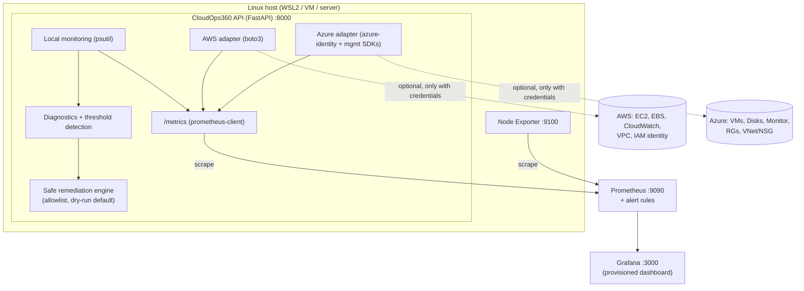
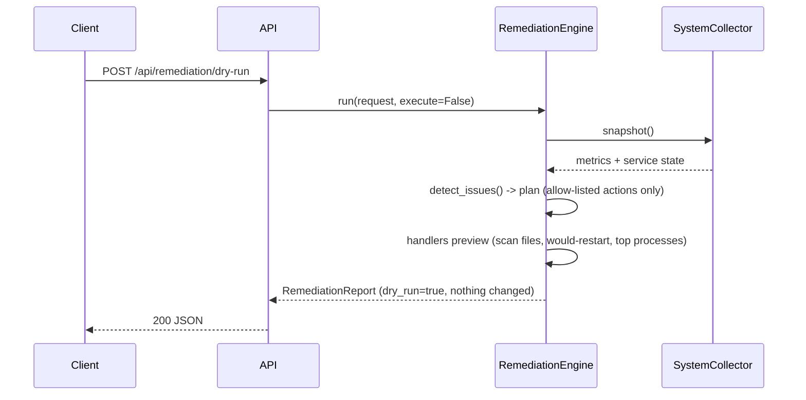

# Architecture

CloudOps360 is a deliberately small version of what a Cloud Operations team runs: collect signals, detect problems,
explain them, and (carefully) fix the ones that are safe to fix.

## Components

| Component | Responsibility | Where |
|---|---|---|
| Collector | psutil snapshot: CPU, memory, filesystems, disk I/O, network, load, uptime, processes, service state | `app/monitoring/system.py` |
| Threshold logic | Compares a snapshot with env-configured thresholds, producing typed `Issue`s | `detect_issues()` |
| Metrics | Custom Prometheus collectors evaluated at scrape time; cloud series come from cached overviews | `app/monitoring/metrics.py` |
| Remediation engine | Plans actions per issue, executes only allow-listed ones, always verifies and reports | `app/remediation/engine.py`, `safety.py` |
| Cloud adapters | Read-only discovery with graceful "not configured" behaviour, TTL cache, background refresh | `app/cloud/*` |
| API | FastAPI routers, request IDs, structured logs, consistent error bodies | `app/api/*`, `app/main.py` |

## Request flow: `POST /api/remediation/dry-run`

## Design decisions

* **LOCAL, AWS and AZURE are always labelled.** API models carry a `provider`; cloud Prometheus series carry a
  `provider` label; local series are unlabelled (`cloudops_*`) and cloud series are `cloudops_cloud_*`.
* **A scrape never calls a cloud API.** A background thread refreshes the adapters; `/metrics` reads the cache.
* **Dependency injection via a container** (`app/container.py`). Tests inject fake collectors, command runners and
  cloud sessions, so the suite needs no cloud account, no systemd and no root.
* **Safety is structural, not procedural.** The request schema forbids unknown fields and the action enum is the
  allowlist, so there is nowhere to pass a command. See [security.md](security.md).
* **Two views of the host.** `cloudops_*` metrics come from psutil inside the API's namespace; Node Exporter gives
  the host's own view. Inside Docker Desktop (WSL2 backend) both describe the Docker VM, not Windows itself.
